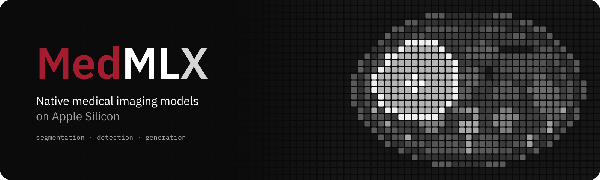

# MedMLX

Community support, organization profile and shared branding for native medical imaging on Apple Silicon.

[Organization](https://github.com/MedMLX) · [Website](https://medmlx.org) · [Hugging Face](https://huggingface.co/MedMLX)



*MedMLX branding.*

## Edit

| Path | Purpose |
| :--- | :--- |
| [profile/README.md](profile/README.md) | GitHub organization landing page |
| [SUPPORT.md](SUPPORT.md) | Model requests, questions, bug reports and shared work |
| [.github/ISSUE_TEMPLATE/](.github/ISSUE_TEMPLATE/) | Default model request and bug report forms, plus discussion links |
| [brand/](brand/) | Logos, banners and social images |
| [brand guide](brand/README.md) | Colors, typography and asset usage |
| [huggingface/](huggingface/) | Hugging Face organization card |
| [tools/](tools/) | Asset generators |

## Generate assets

Requires Python 3.13 or newer, [uv](https://docs.astral.sh/uv/) and the native Cairo library.

```bash
uv sync --locked
brew install cairo
DYLD_FALLBACK_LIBRARY_PATH="$(brew --prefix cairo)/lib" .venv/bin/python tools/make_brand.py
```

The first run downloads IBM Plex fonts into the ignored `tools/.fonts/` cache.
The command overwrites the generated brand assets, including the organization
social card. See the [brand guide](brand/README.md#regenerating) for individual
repository cards and their output directory.

Run `make qa` for local lint and type checks. See [SECURITY.md](SECURITY.md) for vulnerability reporting.

## License

See [LICENSE](LICENSE). Keep `LICENSE` at each project root and upstream code terms in `THIRD_PARTY_NOTICES.md`.
Model weights, datasets and bundled assets retain their own terms and required notices.
