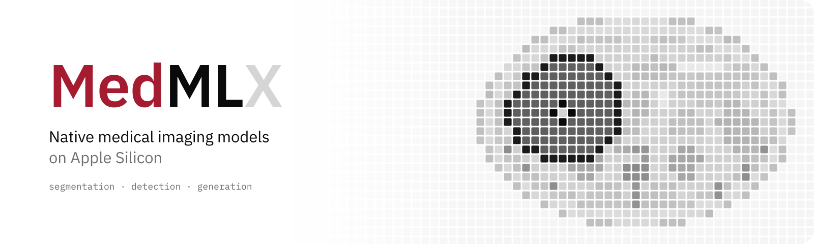

<p>
  <picture>
    <source media="(prefers-color-scheme: dark)" srcset="../brand/banner-dark.svg">
    
  </picture>
</p>

# MedMLX

Native medical imaging on Apple Silicon, built with [MLX](https://github.com/ml-explore/mlx).
Segmentation, detection, synthesis and CT reasoning, running locally on your Mac.

[Website](https://medmlx.org) · [Hugging Face](https://huggingface.co/MedMLX) · [Python API, CLI & MCP](https://github.com/MedMLX/medmlx)

## Get started

Requires Apple Silicon, Metal, Python 3.13 and [uv](https://docs.astral.sh/uv/).

```sh
uv tool install --python 3.13 "medmlx[all,mcp]"
medmlx models
```

Use `medmlx describe <model>` for its inputs and examples. See the package's
[setup guide](https://github.com/MedMLX/medmlx/blob/main/docs/setup.md) for current
automatic-weight support and source-only release features.

## Community

- [Request a model](https://github.com/MedMLX/.github/issues/new?template=model-request.yml) to run on your Mac.
- [Ask a question](https://github.com/MedMLX/.github/discussions/categories/q-a) about installation, model selection or usage.
- [Report a bug](https://github.com/MedMLX/.github/blob/main/SUPPORT.md#report-a-bug) in the affected package.
- [Share your work](https://github.com/MedMLX/.github/discussions/categories/show-and-tell) with MedMLX.

## Models and tools

| Repository | Purpose |
| :--- | :--- |
| [mlx-reason-ct](https://github.com/MedMLX/mlx-reason-ct) | CT reports and questions |
| [flexible-unet-mlx](https://github.com/MedMLX/flexible-unet-mlx) | Endoscopic tool segmentation |
| [swin-unetr-mlx](https://github.com/MedMLX/swin-unetr-mlx) | Abdominal CT segmentation |
| [segresnet-mlx](https://github.com/MedMLX/segresnet-mlx) | CT and brain MRI segmentation |
| [fdg-pet-ct-mlx](https://github.com/MedMLX/fdg-pet-ct-mlx) | Synthetic FDG PET |
| [radimagenet-mlx](https://github.com/MedMLX/radimagenet-mlx) | Radiology image features |
| [unest-mlx](https://github.com/MedMLX/unest-mlx) | Renal CT segmentation |
| [biomedparse-mlx](https://github.com/MedMLX/biomedparse-mlx) | Text-prompted medical segmentation |
| [nnunet-mlx](https://github.com/MedMLX/nnunet-mlx) | nnU-Net v2 inference |
| [totalsegmentator-mlx](https://github.com/MedMLX/totalsegmentator-mlx) | Whole-body CT segmentation |
| [lung-nodule-mlx](https://github.com/MedMLX/lung-nodule-mlx) | Lung nodule detection |
| [synthseg-mlx](https://github.com/MedMLX/synthseg-mlx) | Brain segmentation |
| [mlx-segment-ct](https://github.com/MedMLX/mlx-segment-ct) | Prompted CT segmentation |
| [flexray-mlx](https://github.com/MedMLX/flexray-mlx) | Radiograph segmentation |
| [medsam2-mlx](https://github.com/MedMLX/medsam2-mlx) | Prompted masks and propagation |
| [sam3-mlx](https://github.com/MedMLX/sam3-mlx) | Text- and box-prompted image segmentation |
| [lesiondiffusion-mlx](https://github.com/MedMLX/lesiondiffusion-mlx) | Synthetic CT lesions |
| [mlx-generate-ctmr](https://github.com/MedMLX/mlx-generate-ctmr) | Synthetic CT and MRI |
| [med-vlm-mlx](https://github.com/MedMLX/med-vlm-mlx) | Medical vision-language models |

For research and education. Outputs require human review.
Code, model weights and datasets retain their own licenses; see each repository’s notices.
