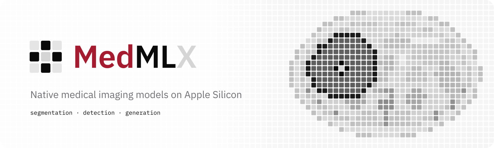

  <picture>
    <source media="(prefers-color-scheme: dark)" srcset="../brand/banner-dark.svg">
    
  </picture>

# MedMLX

Native medical imaging models on Apple Silicon, built with
[MLX](https://github.com/ml-explore/mlx).

- Local model execution on the Mac's Metal GPU
- Segmentation, detection, generation, and CT reasoning
- Numerical checks against the original model implementations

## Public packages

| Repository | Purpose |
| --- | --- |
| [MLX-Reason-CT](https://github.com/MedMLX/MLX-Reason-CT) | NVIDIA NV-Reason-CT port for 3D CT reports and question answering |
| [medmlx-core](https://github.com/MedMLX/medmlx-core) | Shared runtime, tensor operations, and inference helpers |

Each package's README provides requirements, a quick start, supported inputs,
and its validation scope. Model-specific checkpoint instructions and weight
terms are documented with the model.

## Intended use

Research and education. Agreement with an upstream implementation establishes
engineering parity, not clinical validity. Model outputs require human review.
MedMLX is not a medical device and is not affiliated with Apple.

## Licenses

Each repository states its applicable code and dependency licenses and retains
upstream notices. Model weights and datasets have separate terms; follow the
selected model's documentation before use or redistribution.
